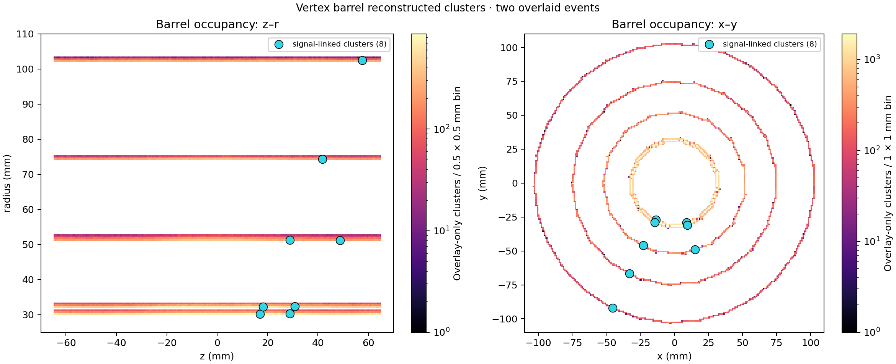
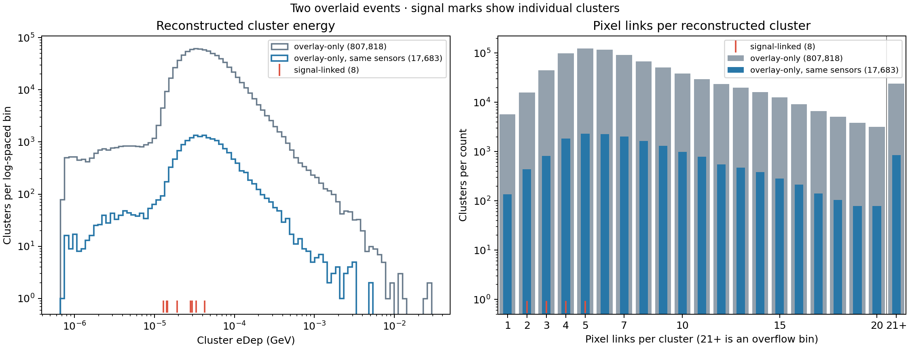
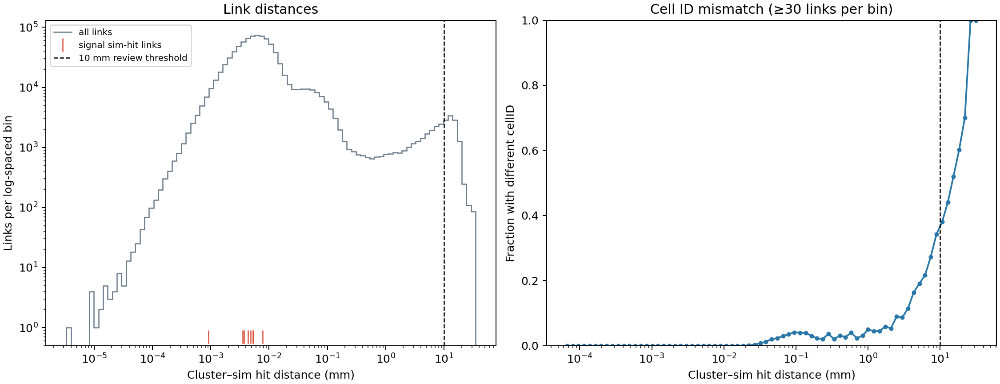
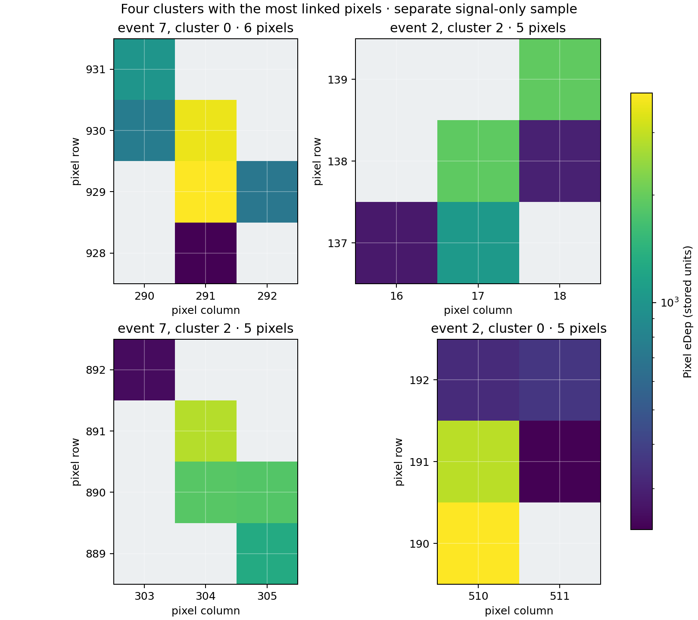

# MAIA vertex digitization: visualization review

This is a first look at reconstructed vertex-barrel clusters in the two-event
`digi_output_mu2` sample with beam-induced background (BIB) overlay. The four
figures are generated by [`plot_maia_digitization.py`](plot_maia_digitization.py),
rather than copied from [`tracklistEdmExploration.ipynb`](tracklistEdmExploration.ipynb).
They show what can be checked from the committed extracted tables; they do not
establish signal–BIB separation performance.

## Inputs and labels

| Input | Available data | Used in |
| --- | --- | --- |
| `digi_output_mu2` BIB-overlay sample | Committed Parquet tables for 807,826 reconstructed clusters, 1,050,847 sim hits (including eight signal hits), 865,866 cluster-to-sim-hit links, and 6,895,324 pixel-to-cluster links across two events | Figures 1–3 |
| `digi_real` signal-only sample | Committed CSV tables with 42 clusters and 140 fired pixels; all 140 pixel rows have `overlay=False` | Figure 4 |

The BIB sample's individual pixel table is unavailable in this checkout. Its
pixel-to-cluster table identifies *which cluster* each pixel belongs to, but
does not provide that pixel's coordinates or stored value. The separate
signal-only sample supplies those values for Figure 4.

For Figures 1–2, **signal-linked** means a cluster has at least one linked sim
hit with `overlay=False`; **overlay-only** means all its linked sim hits have
`overlay=True`. In these two events, eight clusters are signal-linked, 807,818
are overlay-only, and none of the eight mixes signal and overlay sim hits.

## Figures

### 1. Reconstructed-cluster occupancy



Colour counts overlay-only clusters; cyan markers locate the eight
signal-linked clusters. The left view uses 0.5 mm × 0.5 mm bins in z and
radius. The right view uses 1 mm × 1 mm bins in x and y and projects over z.
Both views combine the two events. Their colour scales are separate because
their bin sizes and projections differ. Coordinates are in millimetres.

### 2. Cluster energy and pixel-link count



Gray shows all overlay-only clusters. Blue restricts those clusters to sensor
IDs that contain a signal-linked cluster, pooling the two events. Both are raw
counts, not normalized distributions. Red ticks mark the eight signal-linked
clusters individually; eight observations are too few for a signal
distribution. Their pixel-link counts are `[5, 5, 2, 3, 4, 3, 3, 3]`.

The energy bins are logarithmic. The `eDep` axis uses GeV, the unit specified
for reconstructed hits in the
[EDM4hep schema](https://github.com/key4hep/EDM4hep/blob/main/edm4hep.yaml).
The custom digitizer's unit conversion has not been independently audited.
Pixel-link counts use exact integer bins from 1 to 20 plus a labelled 21+
overflow bin, so every cluster is represented.

### 3. Cluster-to-sim-hit link diagnostics



All 865,866 links resolve by object key. Of these, 10,466 (1.21%) span more
than 10 mm, and 10,097 (1.17%) connect different sensor `cellID` values. The
10 mm line is the linker's *review threshold*, not a physics selection cut.
Distance bins are logarithmic; the mismatch fraction on the right is plotted
only for bins with at least 30 links. A resolved link can still merit a
physical-consistency check.

### 4. Pixel examples from a separate signal-only sample



These are the four clusters with the most linked pixels in `digi_real`; they
are examples, not a representative sample or BIB-overlay pixel maps. The axes
are sensor pixel column and row, not global detector position. Blank gray cells
are unoccupied positions within each displayed bounding box. Colour shows the
pixel's stored `eDep`. Its physical unit in this custom digitizer remains
unverified, so this figure does not call it charge or energy.

## Validation and limits

- The cluster classes, pixel-link total, and signal-cluster pixel counts were
  cross-checked against the committed
  [`linkReport.txt`](edmTestFiles/digi_output_mu2.edm4hep.root.linkReport.txt).
  Re-running the cluster-to-sim-hit linker on the available Parquet tables
  reported `0 check(s) failed`.
- All eight signal sim-hit links have matching cluster/sim-hit `cellID` values
  and distances below 0.008 mm. The more distant and cross-sensor links in
  Figure 3 are predominantly in the overlay sample; their origin still needs
  investigation.
- The transferred `digi_output_mu2.edm4hep.root` copy is truncated and cannot
  be reopened. These figures can be checked against the committed extracted
  tables, but the extraction and custom digitizer cannot be independently
  validated from that ROOT copy.
- The BIB-overlaid sample contains two events, 807,826 clusters, and only eight
  signal-linked clusters. These plots support data inspection and link
  validation, not estimates of efficiency, rejection, or statistical separation.
- The pixel-to-cluster relation allows pixel counts, but it does not contain the
  BIB pixels' coordinates or stored values. Pixel-level truth is also ambiguous
  for clusters linked to multiple sim hits.
- Cluster `time` is 25 for 760,989 of 807,826 rows and 0 for the remainder.
  Its meaning in this digitizer needs checking before a timing plot is used.

Useful points for the dataset owners to review are the pixel `eDep` storage
unit, whether the distant or cross-sensor links are expected, and whether a
complete BIB pixel table or readable ROOT file can be provided. With those
inputs, the next figure should compare signal and BIB pixel shapes in the
*same* overlaid events.

## Reproduce from the committed tables

Run from the repository root with Python packages `numpy`, `pandas`, `pyarrow`,
and `matplotlib`. The source tables are read-only; derived files go under
`local_only`, which is ignored by the repository.

```bash
mkdir -p local_only/maia_linked
MAIA_SRC="$PWD/MuC_Smartpix_Data_Production/MAIADataset/edmTestFiles/digi_output_mu2.edm4hep.root"
MAIA_DST="$PWD/local_only/maia_linked/digi_output_mu2.edm4hep.root"

for suffix in vtxClustersDf.parquet vtxClusterToSimHitDf.parquet \
              vtxBarrelSimHitsDf2.parquet truthParticlesDf2.parquet; do
  ln -sfn "${MAIA_SRC}.${suffix}" "${MAIA_DST}.${suffix}"
done

python3 MuC_Smartpix_Data_Production/MAIADataset/linkEdmHits.py \
  "$MAIA_DST" --no-csv --no-convert-parquet \
  > local_only/maia_linked/link.log 2>&1
tail -n 12 local_only/maia_linked/link.log

python3 MuC_Smartpix_Data_Production/MAIADataset/plot_maia_digitization.py
```

The linker should end with `0 check(s) failed`. It intentionally does not load
the 6.9 million pixel-to-cluster links at this stage. The plotting script reads
those links in Parquet batches to count pixels per cluster, without retaining
all link rows in memory. It saves PNGs, `pixel_counts.npy`, and `summary.json`
in `local_only/maia_visualizations`. Use `--linked-stub`, `--pixel-stub`,
`--pixel-links`, and `--output-dir` to point it at other locations.
The four embedded figures above are copies of those generated PNGs.
